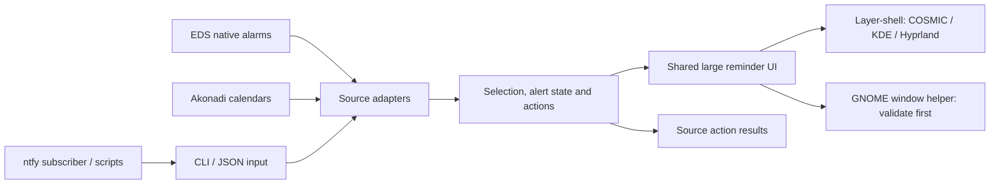

# Attention overlay: problem space and reuse audit

Research date: 2026-10-15. This is a design and evidence report. The proposed CLI, TOML schema, source adapters, and GNOME helper below are not implemented.

## Problem Space

**Scope:** A reusable desktop attention surface for selected calendar reminders and explicitly selected alerts from other tools.

### Objective

We are optimizing for noticing an imminent commitment or a request that needs action, then joining, dismissing, or snoozing it immediately. Success means fewer missed commitments with very little unrelated interruption.

### Constraints

| Constraint | Type | Reason | Question? |
|------------|------|--------|-----------|
| Huge overlay above fullscreen applications, with visible clickable buttons | Hard | The user has already rejected small notifications and mouse-button gestures | No; changing this changes the objective |
| Ordinary desktop notifications retain their own daemon and appearance | Hard | A previous global Dunst takeover was explicitly rejected | No |
| Keep the accepted overlay UI | Hard for current scope | User approved its appearance and controls | Revisit only if a complete replacement meets the same behavior |
| Select calendars and configure behavior using TOML | Hard | Explicit user requirements | Exact schema remains a proposal |
| Reuse configured calendar accounts and existing scheduling when possible | Soft | Avoid duplicate OAuth and calendar engines | Direct provider integrations may serve users without desktop calendars |
| Prefer one UI with portable display support | Soft | Minimize duplicate UI and maintenance | GNOME may require a shell helper or a separate renderer |
| Only selected inputs may interrupt | Hard | General alerts must not accidentally become fullscreen | Source labels describe origin; they are not authentication |
| Support COSMIC, Hyprland/Omarchy, KDE Wayland and GNOME Wayland | Target; unverified outside COSMIC | User wants reuse across desktop environments | Test each environment before claiming support |
| Remain local without a required server | Soft | Existing local calendar setup already works | Optional homelab message transport is useful |

### Terrain

- **Systems:** EDS and possibly Akonadi; local CLI and session D-Bus; GTK4 layer-shell; GNOME Shell; current notification daemon; optional ntfy or timer producers.
- **Stakeholders:** Desktop users who miss small reminders; authors of scripts and integrations; maintainers supporting several compositors.
- **Blast radius:** Replacing the notification daemon affects every application. Bad filtering interrupts for the wrong calendars. Lost snooze state causes missed reminders. Stale messages can interrupt after their event is canceled or their incident is resolved.
- **Precedents/metis:** The accepted overlay and explicit buttons worked for the user. The Python mock is a UI demonstration, not an integration. Previous generic notification takeover must not recur. EDS is already installed and has working calendar sources here.

### Situation Model

- **Explains:** The integration gap is a reliable attention surface with selected inputs and useful actions. Calendar sync, recurrence handling, timer production, and message transport have existing implementations.
- **May hide:** Wake from suspend; expired events; recurrence exceptions; calendar reconnects changing source IDs; action results after the sender exits; multiple alerts or displays competing for focus; presenting and lock-screen behavior.
- **Evidence quality:** Current C source and user observation establish the local COSMIC prototype. Upstream documentation/source establish component capabilities. Cross-desktop behavior and third-party interoperability remain untested.

### Assumptions and Open Questions

- A small GNOME helper may let us keep the GTK UI instead of implementing the UI again in Shell actors. Sane Break demonstrates this pattern with a Qt window; GTK behavior above an already-fullscreen application still needs testing.
- Native calendar alarms should retain their scheduler's snooze/dismiss semantics. Generic CLI alerts and synthetic fallback reminders need our own durable state. Define one authoritative scheduler for each alert.
- Display selection should offer all outputs and explicit output names. Portable focused-output selection is a separate capability, not something layer-shell alone guarantees.
- An alert ID must distinguish source, account/calendar, event and recurrence instance. Stable IDs should allow producers to update or withdraw alerts.
- Start with opt-in external inputs. Decide presenting/quiet policies per source; never infer that every urgent desktop notification deserves an overlay.
- Calendar selection should apply to both native triggered alarms and synthetic fallback alarms. Listing source names/IDs must make configuration understandable.

### Frame-Stress Signals

- An existing maintained app meets the full overlay/button/calendar requirements in actual desktop sessions: reconsider owning this application.
- The GNOME window helper cannot stay above fullscreen apps: use a Shell actor renderer behind the same interface.
- EDS/Akonadi integration starts duplicating recurrence, account management or alarm state: move responsibility back to the provider.
- An external source causes frequent interruptions: narrow eligibility rather than merely restyling alerts.
- The CLI cannot update/cancel or return actions: it is insufficient for durable source adapters.

### Ready for Solution Space?

Yes for comparing a small attention service with source/display adapters and a local CLI. No for claiming a finished universal replacement or copying a third-party display implementation without session validation and checking its file license.

## Accuracy report

| Claim | Status | Evidence | Recommended edit |
|---|---|---|---|
| EDS already handles native alarm triggers, snooze, dismissal and persistence of past/snoozed reminders across sessions. | Verified | [EReminderWatcher API](https://gnome.pages.gitlab.gnome.org/evolution-data-server/libecal/class.ReminderWatcher.html) | Keep those responsibilities with EDS for its native alarms. |
| KAlarm is a complete replacement for the required Wayland overlay. | Misleading/context missing | [KAlarm message display](https://docs.kde.org/stable_kf6/en/kalarm/kalarm/message-display.html) documents deferral and persistent windows, but limits protection from ordinary covering windows to X11 and notes fullscreen notification inhibition. | Useful scheduling/interaction precedent; required Wayland display behavior is not established. |
| Swaynag can show a message with command buttons on the overlay layer. | Verified | [swaynag manual source](https://github.com/swaywm/sway/blob/master/swaynag/swaynag.1.scd) | Reuse as a generic CLI/display precedent; its edge bar is not evidence of the accepted fullscreen UI or GNOME support. |
| Sane Break has layer-shell display code and a GNOME extension that manipulates the same app's windows. | Verified | [Layer-shell code](https://github.com/AllanChain/sane-break/blob/main/src/app/layer-shell/layer-shell.cpp), [GNOME helper](https://github.com/AllanChain/sane-break/blob/main/packaging/linux/gnome/sane-break@allanchain.github.io/extension.js) | Investigate one UI with display helpers before implementing a second UI. This is not proof that the helper works unchanged with GTK or every GNOME release. |
| GNOME requires us to implement our reminder UI again using Shell widgets. | Unsupported | The Sane Break helper identifies its app window, resizes it and requests it be raised/kept above. | A separate Shell renderer is an option, not an established necessity. |
| Focus Timer/GNOME Pomodoro implements its own Shell overlay. | Verified | [screenOverlay.js](https://github.com/focustimerhq/FocusTimer/blob/master/plugins/gnome/extension/screenOverlay.js) | Another display implementation precedent; no evidence it exposes the required generic calendar alert interface. |
| gcalcli can execute an external command for an upcoming calendar event. | Verified | [Event Popup Reminders](https://github.com/insanum/gcalcli#event-popup-reminders) | Candidate Google-only source integration once the overlay has a CLI. The documented remind command needs periodic invocation. |
| vdirsyncer and khal provide useful calendar plumbing without EDS/Akonadi. | Verified with edit | [vdirsyncer](https://vdirsyncer.pimutils.org/en/stable/), [khal usage](https://khal.readthedocs.io/en/latest/usage.html) | They cover synchronization/local calendar access, not the required persistent overlay and action lifecycle by themselves. |
| ntfy can feed an external command or JSON consumer on each received message. | Verified | [ntfy CLI subscriptions](https://docs.ntfy.sh/subscribe/cli/) | Candidate homelab input transport; subscribe/filter locally and pass content as data. Do not build another push server for this task. |
| Standard desktop notifications guarantee fullscreen presentation and actionable buttons. | Incorrect | [Desktop Notifications Specification](https://specifications.freedesktop.org/notification/latest-single/) makes actions optional and defines no fullscreen placement request. | Keep the normal notification server; expose a separate opt-in attention endpoint. |
| oh-shit-meeting already guarantees the required Linux desktop overlay. | Unsupported | [Project README](https://github.com/GiGurra/oh-shit-meeting), [GUI source](https://github.com/GiGurra/oh-shit-meeting/blob/main/internal/gui/gui.go): Linux opens the browser with xdg-open, and JavaScript requests fullscreen on a best-effort basis that may be rejected. | Closest inspected meeting-focused alternative; its desktop overlay guarantee and snooze parity are not established. |
| waylandar's calendar dashboard overlay also means its reminders use a fullscreen alarm overlay. | Incorrect | [Project README](https://github.com/samjoshuadud/waylandar) distinguishes its dashboard/widget from reminders sent via notify-send. | Possible calendar/widget precedent; it does not establish our alarm behavior. |
| No existing project solves this problem. | Unsupported | Search and source inspection cannot prove global absence. | No complete replacement was verified among the inspected projects. |

**High-risk unresolved claims:** Reliability on every target desktop remains unverified. The outstanding operational issue is delivery across fullscreen apps, suspend/resume and daemon restart.

**Claims requiring expert review:** None needed to assess the proposed boundaries. Any later copying or redistribution must follow the licenses of the exact files used; this report copies no third-party implementation.

**Source gaps:** No third-party app or GNOME helper was executed for this audit. Current source is not a promise of compatibility with older distro packages. We have not demonstrated a library with a supported, stable arbitrary-alert API that supplies all required display and action behavior.

**Corrections to apply:** Preserve EDS alarm state instead of replacing all scheduling. Prefer one UI plus a GNOME window helper as the first experiment, with a separate Shell renderer if needed. Treat dashboards, ordinary fullscreen windows, and actual compositor overlay surfaces as different capabilities. Describe TOML, calendar selection, generic CLI and new adapters as proposed until implemented.

## Recommended boundaries (design proposal)



A native alarm adapter translates triggers and delegates snooze/dismiss to the existing scheduler. An event-feed adapter supplies occurrences and changes if it cannot supply ready alarms. Immediate CLI messages need no calendar backend. Each alert has exactly one owner of its scheduling state.

Use our own session D-Bus name/interface for the daemon and a small CLI client. Do not acquire `org.freedesktop.Notifications` or require a notification proxy. Reuse established concepts such as replace IDs and named actions, while adding our selection, persistence and presentation rules.

Do not invent a plugin framework first. A process that emits structured data or calls the CLI is sufficient for early integrations. A future Akonadi helper could use KDE libraries without linking those dependencies into every renderer.

### Proposed CLI

These commands do not exist yet; `overlayctl` is a placeholder name.

```sh
overlayctl notify --source cli --id tea --title 'Tea is ready' --snooze 5m
overlayctl notify --source homelab --id backup-main --title 'Backup needs attention' --url https://status.example.net/
overlayctl update --source homelab --id backup-main --body 'Retry failed'
overlayctl cancel --source homelab --id backup-main
overlayctl calendars list --json
overlayctl notify --json -
```

Minimum input: source, namespaced ID, title and body. Optional data: start/end/expiry timestamps, open URI, action IDs, source revision and calendar identity. Input must support replacement and withdrawal. A machine-readable response/event stream should report displayed, dismissed, snoozed and action-invoked states; an optional wait mode lets simple scripts await a button click.

Use typed actions such as open-uri, dismiss and snooze. For custom buttons, return a chosen action ID to a producer or invoke a locally configured handler. Source messages supply data, not arbitrary shell programs to execute.

Source labels are not a security boundary between local processes. Selecting a source is user policy to control interruptions, while remote credentials and local IPC access are separate concerns.

### Proposed TOML direction

The current binary only reads the existing INI fallback-lead setting. This schema is a proposal, not a usable runtime configuration.

```toml
version = 1

[display]
backend = "auto"
outputs = "all"

[appearance]
title_size_pt = 38
button_size_pt = 23

[reminders]
snooze_minutes = [1, 5, 10]
auto_dismiss_seconds = 0

[sources.eds]
enabled = true
selection = "include"
include = ["eds:example-work-calendar-id"]
fallback_lead_minutes = 5

[sources.eds.overrides."eds:example-work-calendar-id"]
fallback_lead_minutes = 3

[sources.cli]
enabled = true

[sources.homelab]
enabled = false
```

Separate source eligibility, calendar selection, reminder behavior and appearance. Listing calendars shows account, display name, provider ID and selection. An explicit empty include list selects nothing. Missing selected IDs produce diagnostics. Reload should validate the entire configuration and keep the last valid state if a new edit fails.

### Related alerts that fit

These are suggested uses, not findings of medical benefit or a commitment to implement every producer.

| Alert | Reuse/input | Why it merits consideration |
|---|---|---|
| Meeting start, wrap-up or an immediate next meeting | Calendar adapter; explicit rules for each stage | Actions are clear and time-sensitive; suppress duplicate stages for back-to-back meetings |
| User-created countdown or one-off reminder | CLI; an existing timer or scheduler can call it | Same dismiss/snooze interaction without any calendar setup |
| Focus session end or a break the user chose | Existing break/focus tool through a hook/CLI | Existing tools own their timers; no need to invent another break scheduler |
| Agent/build/deployment blocked waiting for the user | Explicit script or tool integration | Bring forward a real request for action, with a link to the relevant task |
| Selected homelab failure requiring intervention | ntfy subscription or producer script | Use deduplication and cancel on recovery; a routine success is not automatically fullscreen |

Eligibility should require an explicit user choice. Routine mail, chat, monitoring chatter and every finished background job do not become overlays by default. Generic alerts show an Open button only when there is a destination; meeting alerts label it Open meeting.

## Suggested next validation

1. Compare an unchanged shared GTK mock with layer-shell on COSMIC, KDE and Hyprland, including an already-fullscreen app and two monitors.
2. Prototype a GNOME helper that identifies our application/role, sizes and raises its ordinary fallback window. Verify its stacking before choosing this over a Shell actor renderer.
3. Define one alert/action contract and test it with a synthetic CLI producer. No live calendar event is needed for UI validation.
4. Add TOML and calendar listing/filtering, ensuring both native and fallback alarm paths obey selection.
5. Test native EDS snooze persistence separately from our synthetic reminder persistence, then add external inputs only as useful.

The decision supported by the audit is to own the selected alert/action/display boundary and reuse source scheduling and transport where available. A complete off-the-shelf replacement remains an open empirical question, rather than an established absence.
